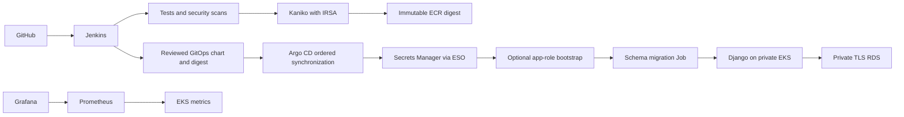

# GoalDevOps v2 — Neoversity final project

**Latest CI evidence:** [Jenkins Build #17 verification](docs/CI-BUILD-17-ACCEPTANCE.md). SCM-backed delivery and remaining live infrastructure acceptance gates are still open.

**Submission implementation uses the existing AWS environment:** account
`227281812993`, region `us-east-2`, EKS `neoversity-lesson-7`. No second cluster
or 39-resource migration is required by the available assignment/mentor criteria.
`deployments/existing-addons/` prepares only new IRSA/CSI/ESO/storage resources in
a separate state; existing resources keep their current owners. Its source is
implemented but not applied. Jenkins restart/storage cutover, IAM, secrets and
application changes still require explicit approval.

The independent `bootstrap/` → `deployments/infra/` → `deployments/platform/`
workflow demonstrates complete source without homework-state dependencies in
mocked offline plans. It has **not** been successfully deployed from scratch;
a second deployment is not proposed merely to obtain evidence. The original
instructor rubric/message is unavailable; mentor feedback is recorded in the
published repository README and no numeric grade is claimed.

**Migration HOLD remains active for existing infrastructure.** This repository contains implemented source
remediation and local validation, not a completed production migration or a
verified 100/100 submission. The existing RDS, monitoring Helm release, state
ownership, data, deployments and private backups have not been changed.
`docs/GoalDevOps.md` defines G01–G20; the separately issued official rubric is
still required for a complete official-requirements reconciliation.

## Architecture and ownership



| Existing owner | Resources retained until approved migration |
|---|---|
| lesson-5 | Backend, VPC/subnets/NAT and lesson-5 ECR |
| lesson-7 | EKS, node group, application ECR |
| lesson-8-9 | Jenkins, Argo CD, Kaniko identity |
| final-project | Existing RDS and monitoring Helm release |

The root is a **held migration target**. Its unified declarations do not transfer
ownership. Keep database/monitoring enabled; never reuse the old “safe” plans.
Legacy planning helpers fail closed. Historical evidence is labeled separately.

For a distinct clean environment, `bootstrap/` → `deployments/infra/` →
`deployments/platform/` implements staged bootstrap without earlier lesson-state
dependencies. Use different names/keys; never point these roots at existing
lesson resources. Detailed prerequisites, IAM, private-runner access, bootstrap,
plan/apply review, CI image build, secrets, storage and cleanup are in
[deployment guide](docs/DEPLOYMENT.md). Actual apply/deployment requires separate
explicit authorization. Existing-state continuity and rollback are in the
[migration runbook](docs/MIGRATION-RUNBOOK.md). The consolidated approval and
execution program for that optional migration is [EXECUTION-PLAN.md](docs/EXECUTION-PLAN.md), with exact
G01–G20 evidence in [ACCEPTANCE-EVIDENCE.md](docs/ACCEPTANCE-EVIDENCE.md).

For the existing-environment implementation, use the [additive deployment instructions](docs/DEPLOYMENT.md#existing-environment-additions-without-migration).
The root Terraform directory remains a held migration target and must not be applied.
The clean-deployment commands document independent reproducibility, not permission
to create another cluster.

## Local checks

Use Python 3.12, Terraform >=1.14, Helm v3, Trivy, and hash-locked dependencies.
Create an isolated environment and install `Django/requirements.txt` plus
`ci/requirements.txt` with `pip install --require-hashes`. Do not install into
system Python. Set `PYTHON` to that environment's interpreter for scripts.

For previously uninitialized source roots, initialize dependencies only using
`terraform init -backend=false -input=false -lockfile=readonly` in each of `.`,
`bootstrap`, `deployments/infra`, `deployments/platform` and `deployments/existing-addons`. Initialization writes
local metadata and accesses provider registries; it does not prove authenticated
backend initialization or authorize deployment. Prefer a disposable source copy
for an audit requiring zero repository writes.

```bash
terraform fmt -check -recursive
terraform validate -no-color
helm lint charts/django-app --set config.POSTGRES_HOST=example.invalid
bash scripts/goaldevops-source-check.sh
STRICT_SECURITY=true bash scripts/security-scan.sh
terraform -chdir=deployments/infra test -no-color
```

The source suite validates all five roots, three local charts, the four RDS
engine/mode combinations, additive storage/OIDC rejection, offline safety,
chart-ordering/configuration regressions, and Django tests without a database.
The infrastructure Terraform test uses mocked AWS providers and plan-only runs.
A missing hostname must fail real chart rendering; bare lint can merely log it.
The source-check script does not initialize providers or silently skip tools.
Strict security scanning returns nonzero on HIGH/CRITICAL findings. Hardened
source now has none; continuity still exposes the historical 2 CRITICAL/5 HIGH.
Runtime image findings and unverified deployments remain separate blockers;
raw findings stay private under ignored reports and only summaries are printed.

## Application and local development

`Django/` preserves Compose PostgreSQL/Nginx development, with an explicit
`DJANGO_LOCAL_DEVELOPMENT=1` switch. The production image runs non-root, serves
collected static files, requires secrets/hosts, and verifies RDS TLS with the
official CA bundle. Kubernetes runs migrations in a single ordered Job; it does
not migrate from every web replica. `/live/` is independent of RDS; `/health/`
checks database access and the migrated application table. The homepage retains
its visit-counter write; it is deliberately excluded from read-only smoke tests.

For local development, copy `Django/.env.example` to `Django/.env`, replace the
local placeholders, then run:

```bash
docker compose --env-file Django/.env -f Django/docker-compose.yaml up -d --build
```

The example uses localhost:8080. Docker ignore files exclude live credentials
and local state from build contexts.

The default Service is ClusterIP. Public exposure requires reviewed HTTPS,
DNS, ingress/controller/certificate prerequisites, trusted-proxy/CSRF/HSTS
settings and explicit allowed hosts. Secure cookies are enabled in production.
The optional database-bootstrap Job mutates roles/grants and must not run
against an existing database without separate review and authorization.

## CI/CD and GitOps

`Jenkinsfile` and its compatibility copy `Django/Jenkinsfile` are checked for
identity. The seed job targets `final-project/Jenkinsfile` on `final-project`.
The CI tools image is built from `ci/Dockerfile` and supplied by verified digest.
CI checks out the exact source SCM revision, runs tests and scans, reuses/builds
an immutable full-SHA image, scans it, preserves environment values while
aligning the chart, and updates the GitOps digest. Extra files, symlinks and customized existing templates block automation for
review instead of being overwritten. Initial alignment requires an exact
reviewed GitOps base commit; later canonical templates have hash provenance. Delivery verification requires
the expected GitOps revision, image, replicas and DB/schema health through
read-only namespace RBAC. The current submitted pipeline has not yet been executed on the existing controller.
It now runs strict IaC/rendered-chart and dependency/secret scans before building.

ESO injects separate read/write GitOps tokens and application/admin/signing
secrets. Terraform never stores generated app/signing passwords in state.
Externally issued GitHub tokens still require secure authorized provisioning.
Jenkins uses encrypted gp3 storage and a protected standalone PVC in the new
platform root. The existing controller needs a separately approved backup,
restore, cutover and replacement-survival test; enabling persistence is not a
backup migration. See the deployment guide for the restore tool and suspended
restore Job template.

## Runtime inspection and verification

After environment approval and deployment, inspect without exposing Secret data:

```bash
kubectl get all -n jenkins
kubectl get all -n argocd
kubectl get all -n monitoring
kubectl -n neoversity get deploy,hpa,svc
kubectl -n jenkins port-forward svc/jenkins 8080:8080
kubectl -n argocd port-forward svc/argocd-server 8081:443
kubectl -n monitoring port-forward svc/monitoring-grafana 3000:80
```

Use separate terminals for port-forwards: Jenkins http://localhost:8080,
Argo CD https://localhost:8081, Grafana http://localhost:3000. Review the Argo
certificate locally; do not publish credentials or screenshots containing them.
The Terraform `argocd_password_command` output is a retrieval instruction, not
the password. Execute secret retrieval privately only when required.

`bash scripts/verify-final.sh` runs local checks and writes an honest gate report.
To collect read-only runtime evidence, supply explicit `--runtime --context ...
--cluster ... --region ... --rds-id ... --app-url ...` arguments. It verifies
cluster/context agreement and never dumps Secrets. It remains nonzero while
any gate is unproven. `BASE_URL=... bash scripts/smoke-test.sh` uses read-only
health/liveness requests. HPA scaling, persistent restart survival, authenticated
UIs/live dashboard metrics, repeated drift-free plans, and controlled cleanup
require their own real evidence; no source test substitutes for those checks.

## Security, evidence and submission

Read [security dispositions](docs/SECURITY-DISPOSITIONS.md),
[requirements mapping](docs/REQUIREMENTS-MAP.md), and
[remediation report](docs/REMEDIATION-REPORT.md). Legacy security settings remain
unchanged for continuity and require separately reviewed security plans. The
archived Kaniko builder needs an actual image scan and a maintained-builder
migration or accepted disposition. Runtime gates stay open while credentials,
SCP permissions, backups, deployment and official-rubric evidence are missing.

```bash
python3 scripts/package-submission.py
```

This creates a deterministic **draft** ZIP plus checksums under ignored `dist/`,
including an allowlisted source manifest, and excluding state, plans, credentials,
private backups, reports, caches and live tfvars. `--final` requires a clean
reviewed `final-project` branch and all twenty gates passed with evidence. No
commit or push is performed by packaging. Do not label a draft a final submission.

## Troubleshooting, costs and cleanup

The deployment guide covers ESO/IAM/KMS failures, CSI/PVC/AZ binding, Argo
ordering, database TLS/schema/grants, HPA metrics and monitoring. Backend state
uses native S3 locking; bootstrap also defines a protected legacy DynamoDB table.
Different lock mechanisms do not replace a coordinated migration write-freeze.

EKS, EC2, NAT, RDS, EBS and public load balancers incur regional charges. Single
NAT and single-AZ database are lab availability tradeoffs. Cleanup is prohibited
under HOLD. A later approved teardown must stop reconcilers, preserve verified
Jenkins/DB backups, retire platform consumers before infrastructure, review RDS
protection/final snapshots and retained volumes, and keep KMS/backend resources
until every dependent state and recovery artifact has been safely retired.
