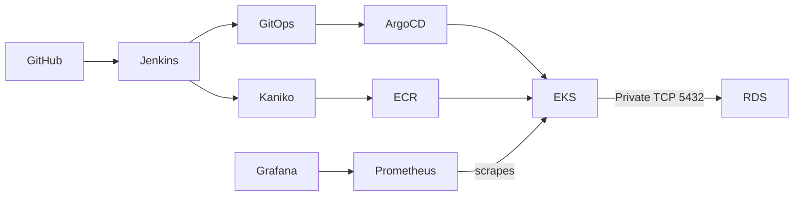

# Neoversity Final DevOps Project — AWS EKS + CI/CD + Monitoring

## Architecture and ownership



- `lesson-5` state owns VPC, subnets, NAT and its ECR repository.
- `lesson-7` state owns EKS, managed node group and Django ECR repository.
- `lesson-8-9` state owns Jenkins, Argo CD and Kaniko identity. **Upgrade these in their existing state**, not from this new state.
- `final-project` state owns **only new RDS and Prometheus/Grafana Helm release**. Existing resources are read via data sources and remote-state outputs.

## Start: one safe preparation command

```bash
cd ~/Neoversity/my-microservice-project/final-project
unset AWS_ACCESS_KEY_ID AWS_SECRET_ACCESS_KEY AWS_SESSION_TOKEN AWS_PROFILE
aws login --remote --region us-east-2
# AWS CLI login can require exported temporary credentials for Terraform S3 backend:
eval "$(aws configure export-credentials --format env)"
bash scripts/prepare-final.sh
```

The safe plan uses `deploy_database=false` and `deploy_monitoring=false`. Review any proposed changes carefully. The S3 bucket already exists; this project must not recreate or destroy it.

## Optional deployment plan (billable)

```bash
bash scripts/plan-new-resources.sh
terraform show -no-color final-infra.tfplan
# Only after reviewing changes, cost and resource ownership:
terraform apply final-infra.tfplan
```

The database is PostgreSQL with AWS-managed Secrets Manager credentials, encrypted storage, private subnets and SG restricted to the EKS cluster security group. Django must still be configured to consume the secret and use the endpoint; this is not automated by this initial package. **Never commit password values**. The monitoring release name is `monitoring`, namespace `monitoring`.

## Verify Jenkins and Argo CD

```bash
kubectl -n jenkins get pods
kubectl -n argocd get application django-gitops
kubectl -n jenkins port-forward svc/jenkins 8080:8080
# In another terminal:
kubectl -n argocd port-forward svc/argocd-server 8081:443
```

Jenkins pipeline currently sources `lesson-8-9/Jenkinsfile`; final pipeline integration must be changed deliberately, keeping source and GitOps repository tag paths consistent.

## Verify Prometheus and Grafana

```bash
kubectl -n monitoring get pods
kubectl -n monitoring get svc
kubectl -n monitoring port-forward svc/monitoring-grafana 3000:80
kubectl -n monitoring get configmap -l grafana_dashboard=1
```

The `monitoring/dashboard-configmap.yaml` defines a project-specific dashboard. After monitoring installation, apply it using `kubectl apply -f monitoring/dashboard-configmap.yaml`. Grafana sidecar discovers the labeled ConfigMap.

## TOP 1–4

- TOP 1: `bash scripts/smoke-test.sh` — checks `/health/` (PostgreSQL `SELECT 1`) and `/` HTTP success.
- TOP 2: Grafana dashboard `monitoring/dashboards/neoversity-devops.json`.
- TOP 3: `bash scripts/security-scan.sh` — Trivy IaC scanning; remediate findings, don't blindly ignore them.
- TOP 4: `bash scripts/verify-final.sh` — consolidated evidence under `reports/`.

## Mentor feedback to close before submission

- RDS: added `db_name` output and default `max_connections=100`; verify Aurora PostgreSQL cluster vs instance parameter behavior against engine/version and database metadata; check example plans for all four modes.
- Jenkins: enable persistence using EBS CSI driver and StorageClass, migrate away from Pod Identity to IRSA if required by rubric, and provision GitHub credential via JCasC backed by Kubernetes Secret (not a Terraform plaintext secret).
- Argo CD: admin password retrieval command output added; for private GitOps repo include a secure repository secret/chart template.
- Django: use RDS instead of in-cluster PostgreSQL, with proper secret injection and schema migration; demonstrate a successful build on `final-project`, not only `lesson-8-9`.

## Clean up / cost

Only destroing resources belonging to this new state after reviewing them:

```bash
terraform plan -destroy
# Review, then if appropriate:
terraform destroy
```

I do not destroy old lesson-5, lesson-7 or lesson-8-9 states just to clean up this new project. Existing EKS, NAT Gateway, EC2 nodes and load balancer remain billable until separately cleaned up. Keep S3 backend and lock records until all states have been safely retired.
