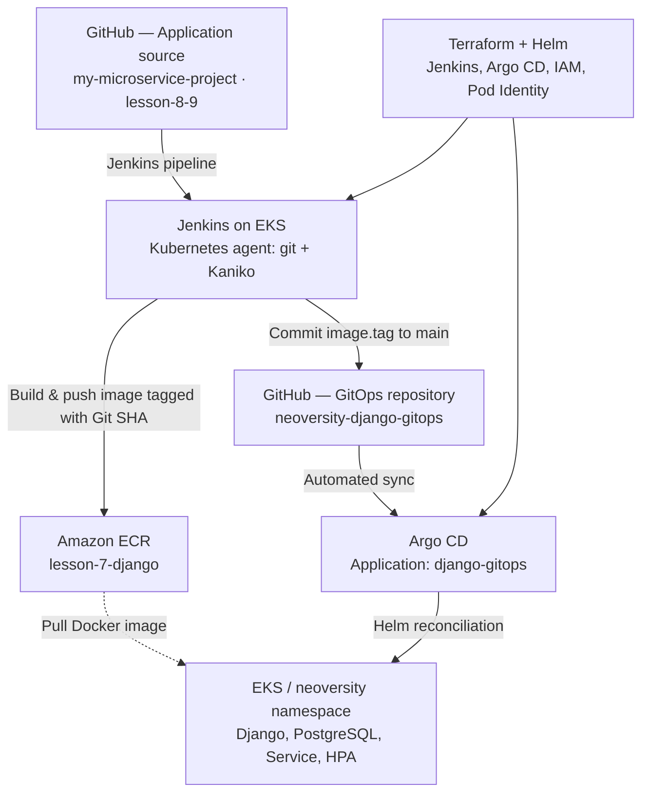

# Neoversity DevOps — Homework 8–9
### End-to-End CI/CD with Jenkins, Kaniko, Amazon ECR, Terraform, Helm & Argo CD

[](https://github.com/fedorstoiets/my-microservice-project/tree/lesson-8-9)
[](https://aws.amazon.com/eks/)
[](https://github.com/fedorstoiets/neoversity-django-gitops)

> **Coursework scope.** This project implements a working build → publish → GitOps commit → deploy pipeline for the Django application developed in earlier assignments. Jenkins and Argo CD are installed with Terraform-managed Helm releases into an existing Amazon EKS cluster. The cluster, VPC, and ECR repository are **reused**, not recreated.

## 1. Project overview

A commit in the source repository is checked out by the Jenkins pipeline running on a Kubernetes agent. **Kaniko** builds the Django image without a Docker daemon and pushes it to **Amazon ECR** using EKS Pod Identity. Jenkins then writes the source commit SHA as `image.tag` in a **separate GitOps repository** and pushes to its `main` branch. **Argo CD** detects the Git change, automatically syncs the Helm chart, and updates the Django Deployment.

### Architecture



### Repositories

| Purpose | Repository / branch |
|---|---|
| Django source, Jenkinsfile, Terraform, documentation | [`my-microservice-project` — `lesson-8-9`](https://github.com/fedorstoiets/my-microservice-project/tree/lesson-8-9) |
| Desired application state / Helm chart | [`neoversity-django-gitops` — `main`](https://github.com/fedorstoiets/neoversity-django-gitops) |

### Deployed environment

| Setting | Value |
|---|---|
| AWS region | `us-east-2` (Ohio) |
| EKS cluster | `neoversity-lesson-7` |
| Existing VPC | Provisioned by Homework 5 |
| ECR repository | `lesson-7-django` |
| Jenkins namespace / job | `jenkins` / `django-ecr-gitops` |
| Argo CD namespace / Application | `argocd` / `django-gitops` |
| Application namespace | `neoversity` |
| Terraform S3 state key | `lesson-8-9/terraform.tfstate` |

## 2. Repository layout

```text
lesson-8-9/
├── Jenkinsfile                         # Kubernetes agent + GitOps pipeline
├── main.tf                             # Providers, namespaces, existing EKS/ECR, modules
├── backend.tf                          # S3 Terraform remote state
├── backend.hcl.example                 # Non-secret backend config example
├── outputs.tf                          # Jenkins, Argo CD, cluster and IAM outputs
├── modules/
│   ├── jenkins/                        # Jenkins Helm release and JCasC seed job
│   ├── argo_cd/                        # Argo CD Helm release and Application chart
│   └── kaniko_identity/                # EKS Pod Identity and scoped ECR IAM permissions
├── gitops-repo/
│   └── charts/django-app/              # Seed Helm chart for separate GitOps repository
└── scripts/
    ├── preflight.sh
    ├── prepare.sh
    ├── setup-gitops.sh
    ├── post-install.sh
    └── cleanup.sh
```

The GitOps repository owns the **desired deployment configuration**, while Terraform owns CI/CD platform services and AWS IAM integration.

## 3. Prerequisites and security

- Ubuntu WSL (or Linux) with `aws`, `terraform`, `kubectl`, `helm`, `git`, `gh`.
- AWS account access in region `us-east-2`; active EKS cluster `neoversity-lesson-7`, working nodes and existing ECR repository `lesson-7-django`.
- Existing Terraform state bucket from Homework 5, configured in `backend.hcl`.
- GitHub CLI authenticated as a user who can create and push to `neoversity-django-gitops`.
- Existing Kubernetes Secret `django-app-secrets` in namespace `neoversity`; this chart references it, but **passwords are never stored in Git**.
- One fine-grained GitHub token with **Contents: Read and write** permission for **only** `neoversity-django-gitops`, stored as a Jenkins **Secret text** credential, ID `github-gitops-pat`.

**Security approach:** No long-lived AWS access keys in Jenkins, no tokens in Terraform/Helm/Git, and Jenkins/Argo CD dashboards available via `kubectl port-forward` rather than public internet load balancers. Kaniko uses the `kaniko-builder` Kubernetes ServiceAccount and EKS Pod Identity with ECR-scoped IAM permissions.

> **Cost warning:** EKS, worker EC2 instances, the NAT Gateway and the application's LoadBalancer generate ongoing AWS charges. Follow the cleanup order in §9 after recording submission evidence.

## 4. Apply Terraform — Jenkins + Argo CD

> The instructions below assume the existing Homework 5/7 infrastructure is still available. **Do not run** Homework 8–9 Terraform until its cluster and ECR prerequisites exist.

### 4.1 Authenticate and check prerequisites

```bash
cd ~/Neoversity/my-microservice-project
git switch lesson-8-9
cd lesson-8-9

# Remove stale exported credentials if necessary:
unset AWS_ACCESS_KEY_ID AWS_SECRET_ACCESS_KEY AWS_SESSION_TOKEN AWS_PROFILE
aws login --remote --region us-east-2

# This Terraform version may require exported temporary credentials for its S3 backend.
eval "$(aws configure export-credentials --format env)"
aws sts get-caller-identity --query Account --output text

aws eks update-kubeconfig --region us-east-2 --name neoversity-lesson-7
kubectl get nodes
bash scripts/preflight.sh
```

If the AWS login has not expired, there is no need to repeat the login. Do **not** print or commit the exported credentials.

### 4.2 Create the GitOps repository (first setup only)

```bash
gh auth login
bash scripts/setup-gitops.sh
gh repo view fedorstoiets/neoversity-django-gitops
```

This initializes `neoversity-django-gitops` with the Helm chart in branch `main`. Skip this step if the repository already exists.

### 4.3 Initialize, validate, plan, apply

```bash
cd ~/Neoversity/my-microservice-project/lesson-8-9

# Once only: create backend.hcl from backend.hcl.example if missing.
# Never commit backend.hcl or plan/state files.
test -f backend.hcl || cp backend.hcl.example backend.hcl

terraform init -backend-config=backend.hcl
terraform fmt -check -recursive
terraform validate

terraform plan -out=deploy.tfplan
terraform show -no-color deploy.tfplan | grep -E 'will be created|will be destroyed|must be replaced|Plan:'

# Review the plan before executing it.
terraform apply deploy.tfplan
bash scripts/post-install.sh
```

Expected changes: namespaces, Jenkins and Argo CD Helm releases, Argo CD Application chart, EKS Pod Identity agent/association, builder ServiceAccount and scoped IAM resources. The plan should **not** recreate the VPC, EKS cluster or ECR repository. If an add-on already exists, reconcile/import it instead of blindly creating a duplicate.

### 4.4 Confirm installation

```bash
kubectl -n jenkins get pods,svc
kubectl -n argocd get pods,svc
kubectl -n argocd get application django-gitops
kubectl top nodes
```

The Jenkins controller and Argo CD components should be running. The Application should eventually become `Synced` and `Healthy`.

**Ownership transition:** If the older Homework 7 `django-app` Helm release still manages the same objects, it must be removed before Argo CD can own them:

```bash
helm list -n neoversity
helm uninstall django-app -n neoversity
kubectl -n argocd annotate application django-gitops \
  argocd.argoproj.io/refresh=hard --overwrite
```

Only execute the uninstall after confirming the new GitOps configuration is available. The lab's ephemeral PostgreSQL storage will lose its previous data. Keep `django-app-secrets`.

## 5. Verify the Jenkins job

### 5.1 Access Jenkins safely

On Ubuntu, keep this command running in a **separate terminal**:

```bash
kubectl -n jenkins port-forward svc/jenkins 8080:8080
```

Open **http://127.0.0.1:8080**. From Windows, the port forward can also be started through WSL:

```powershell
wsl -d Ubuntu -- kubectl -n jenkins port-forward svc/jenkins 8080:8080
```

If Windows/WSL localhost forwarding is unavailable, troubleshoot local binding rather than publicly exposing Jenkins.

Get the admin password locally (never paste it into the README, GitHub or LMS):

```bash
kubectl -n jenkins get secret jenkins \
  -o jsonpath='{.data.jenkins-admin-password}' | base64 -d
echo
```

### 5.2 Configure GitHub credential

In Jenkins: **Manage Jenkins → Credentials → System → Global credentials → Add Credentials**.

| Credential field | Value |
|---|---|
| Kind | Secret text |
| Scope | Global |
| ID | `github-gitops-pat` |
| Secret | Fine-grained GitHub token for GitOps repo |
| Required permission | Contents: Read and write (`neoversity-django-gitops` only) |

The token is used to push the changed Helm `values.yaml` to GitOps `main`. Do not add the token to a pipeline file or print it in console logs.

### 5.3 Run and inspect the pipeline

Open **Jenkins → `django-ecr-gitops` → Build Now → Build number → Console Output**.

The seeded job reads `lesson-8-9/Jenkinsfile` from the source repository. Its stages are:

1. **Checkout Django source** — clone `lesson-8-9`, derive a short Git SHA.
2. **Kaniko build and ECR push** — build the root Dockerfile; publish `<account>.dkr.ecr.us-east-2.amazonaws.com/lesson-7-django:<short-sha>`.
3. **Update GitOps main** — change `charts/django-app/values.yaml` `image.tag`, commit and push to `main`.

A completed run ends in **`Finished: SUCCESS`**. The source SHA tag makes it easy to trace the deployed artifact to its source commit.

**Verified example (November 11, 2026):** Jenkins Build **#5** succeeded; image tag `fea9e0c3973a` was pushed to ECR and committed to the GitOps repository.

## 6. See the result in Argo CD

### 6.1 Argo CD web UI

Run in a separate terminal:

```bash
kubectl -n argocd port-forward svc/argocd-server 8081:443
```

Open **https://127.0.0.1:8081** (the certificate may be self-signed). Sign in as `admin`; obtain the initial password, if the initial secret still exists:

```bash
kubectl -n argocd get secret argocd-initial-admin-secret \
  -o jsonpath='{.data.password}' | base64 -d
echo
```

Select **Applications → `django-gitops`** and inspect **Sync Status**, **Health Status**, Git revision, and the resource graph. The application is configured to watch GitOps branch `main` and automatically reconcile the Helm chart.

### 6.2 CLI verification (no UI required)

```bash
echo "=== GitOps latest commit ==="
gh api repos/fedorstoiets/neoversity-django-gitops/commits \
  --jq '.[0] | {sha: .sha, message: .commit.message}'

echo "=== Desired image (GitOps main) ==="
gh api repos/fedorstoiets/neoversity-django-gitops/contents/charts/django-app/values.yaml \
  --jq '.content' | base64 -d | grep -A 3 '^image:'

echo "=== Argo CD sync and health ==="
kubectl -n argocd get application django-gitops

echo "=== Actual image (running Kubernetes deployment) ==="
kubectl -n neoversity get deployment django-app \
  -o jsonpath='{.spec.template.spec.containers[0].image}{"\n"}'

echo "=== Application resources ==="
kubectl -n neoversity get deployment,pods,svc,hpa
```

**Acceptance check:** Argo CD = `Synced` / `Healthy`; GitOps image tag = deployed Django image tag; Django = 2/2 ready replicas; PostgreSQL = 1/1; HPA reports CPU metrics and 2–6 replicas.

For the public Django endpoint:

```bash
LB=$(kubectl -n neoversity get svc django-app \
  -o jsonpath='{.status.loadBalancer.ingress[0].hostname}')
curl -i --max-time 20 "http://${LB}/"
```

Expect an HTTP `200 OK` response when the application's LoadBalancer is ready.

### Verified end-to-end result

| Evidence | Observed result |
|---|---|
| Jenkins | Build **#5** — successful |
| GitOps commit | `687f25e63e452ed0e8d84a6c9338eb6c970e376b` |
| GitOps image tag | `fea9e0c3973a` |
| Running EKS image | `lesson-7-django:fea9e0c3973a` |
| Argo CD Application | `django-gitops` — **Synced / Healthy** |
| Django / PostgreSQL | **2/2** Django and **1/1** PostgreSQL Ready |
| HPA | CPU **2% / 70%** target; minimum 2, maximum 6 |

This confirms that Jenkins updated GitOps `main` and Argo CD reconciled the deployed Django image without a manual `helm upgrade` or `kubectl set image` step.

## 7. How to demonstrate a new automated release

To demonstrate the process again, change a harmless application file in source branch `lesson-8-9` and push it. Then click **Build Now** in Jenkins and check:

1. A new SHA-tagged ECR image is created.
2. GitOps `main` receives a commit `ci: deploy Django image <sha>`.
3. Argo CD automatically syncs.
4. The running Deployment image uses the new tag.

Do not manually edit the running Deployment: the **GitOps repository is the source of truth**.

## 8. Troubleshooting

| Symptom | Likely cause / action |
|---|---|
| `ExpiredToken` or `no valid credential sources` | Clear expired exported AWS variables, refresh `aws login`, export credentials for Terraform backend if needed |
| `kubectl` points to stale `us-east-1` URL in Windows | Run `kubectl` through configured Ubuntu WSL or refresh Windows kubeconfig for `us-east-2` |
| Jenkins `localhost:8080` refused | Restart port forwarding and keep its terminal open |
| `Invalid option type "timestamps"` | Remove `timestamps()` from Jenkinsfile if the plugin is not installed |
| Kaniko cannot find `docker-credential-ecr-login` | Ensure Kaniko container `PATH` contains `/kaniko` |
| GitOps `Authentication failed` | Verify Jenkins `github-gitops-pat` has a valid token with Contents write on the GitOps repository |
| Argo CD out of sync | Inspect Application events and GitOps commit; check previous Helm release ownership and application secrets |
| Pod `Pending` | Inspect `kubectl describe pod` / events and EKS node memory/capacity |

## 9. Cleanup and cost control

**After capturing evidence and submitting to LMS**, delete resources in dependency order:

1. Remove the Argo CD-managed Django Application and confirm the **AWS LoadBalancer is deleted**. Preserve required logs/screenshots first.
2. Destroy Homework 8–9 Terraform resources: Jenkins, Argo CD, Application Helm release and Kaniko Pod Identity/IAM.
3. Destroy Homework 7 EKS/node group resources **only after** Kubernetes services and load balancers are removed.
4. Destroy Homework 5 VPC/NAT/ECR resources **only after** EKS is fully deleted, keeping the Homework 5 S3 state bucket and DynamoDB table until any state migration or final backend cleanup is deliberately handled.

For Homework 8–9, use the included interactive script:

```bash
cd ~/Neoversity/my-microservice-project/lesson-8-9
bash scripts/cleanup.sh
```

**Review the destroy plan carefully**. Do not run `terraform destroy` in Homework 5 while the S3 backend bucket is still being managed by the same state. The Homework 8–9 cleanup alone does **not** stop EKS, EC2 or NAT Gateway billing.

> For coursework, Jenkins persistence is disabled and PostgreSQL uses ephemeral storage. These choices reduce complexity but are not production-ready.

## 10. Submission (GoIT Neoversity)

**Source branch:** https://github.com/fedorstoiets/my-microservice-project/tree/lesson-8-9  
**GitOps repository:** https://github.com/fedorstoiets/neoversity-django-gitops

Create the final ZIP from the committed source branch:

```bash
cd ~/Neoversity/my-microservice-project
git switch lesson-8-9
git status
git add lesson-8-9/README.md
git commit -m "Document Jenkins Terraform and Argo CD deployment"
git push origin lesson-8-9

git archive --format=zip \
  --output="/mnt/c/Users/Vladi/Downloads/lesson-8-9_Стоєцький_Федір.zip" \
  lesson-8-9 lesson-8-9/
```

Attach `lesson-8-9_Стоєцький_Федір.zip` and the source branch link to LMS. Recommended supporting evidence: Jenkins successful build console, ECR tag, GitOps commit and Argo CD `Synced / Healthy` view.

---

*Homework 8–9 · Jenkins + Kaniko + Terraform + Helm + Argo CD · AWS us-east-2*
