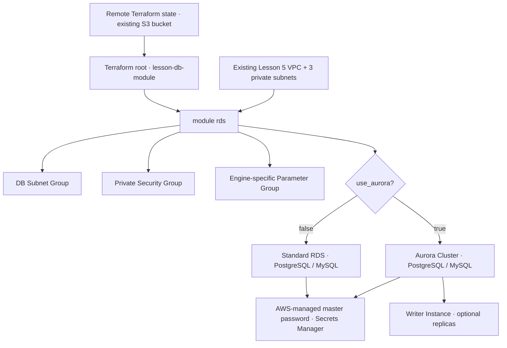

# Neoversity DevOps · Reusable AWS RDS / Aurora Terraform Module

**Homework:** Створення гнучкого Terraform-модуля для баз даних  
**Branch:** `lesson-db-module` · **AWS region:** `us-east-2` · **IaC:** Terraform / AWS Provider 6.x

> One module, four database configurations: **RDS PostgreSQL**, **RDS MySQL**, **Aurora PostgreSQL**, and **Aurora MySQL**. Switching `use_aurora` selects between an individual `aws_db_instance` and an `aws_rds_cluster` plus a writer instance. This project reuses the private network from Homework 5 and an existing S3 Terraform backend.

## Architecture



### Design principles

- **Reusable and typed:** all inputs have types, descriptions, and practical defaults; engine choice and resource variants use conditional Terraform resources.
- **Network isolation:** database is never publicly accessible; private DB Subnet Group and dedicated Security Group. No inbound rules unless you explicitly provide an authorized application security group or trusted CIDR.
- **Credentials:** AWS RDS manages master passwords in Secrets Manager. No password variable, output, or plaintext secret in state.
- **Data protection:** encrypted storage, automatic backups, optional deletion protection and snapshots.
- **Version-awareness:** `aws_rds_engine_version` resolves the engine version and matching parameter-group family. For production, pin an explicit supported `engine_version`.
- **Independent cleanup:** this module references (but does **not own**) the Homework 5 VPC or shared state bucket.

## Repository structure

```text
lesson-db-module/
├── main.tf                 # Instantiates reusable module; reads Lesson 5 network outputs
├── variables.tf            # Root settings, validation, defaults
├── outputs.tf              # Type-independent DB endpoint, ARN, secret ARN
├── backend.tf              # S3 state, native S3 lockfile
├── backend.hcl.example     # Example configuration for existing state bucket
├── terraform.tfvars.example
├── modules/
│   └── rds/
│       ├── shared.tf       # Subnet group, SG, DB engine version, parameter groups
│       ├── rds.tf          # Single RDS instance (count conditional)
│       ├── aurora.tf       # Aurora cluster and writer (count conditional)
│       ├── variables.tf   # Reusable module API
│       └── outputs.tf     # Consistent interface for either mode
├── examples/
│   ├── rds-postgres.tfvars
│   ├── rds-mysql.tfvars
│   ├── aurora-postgres.tfvars
│   └── aurora-mysql.tfvars
└── scripts/
    ├── prepare.sh          # Create ignored local configuration
    ├── run.sh              # Validate, plans, optional apply, destroy
    └── verify.sh           # Inspect deployed RDS resources
```

## Quick start · one-pass workflow

Prerequisites: Ubuntu WSL or Linux, Terraform >= 1.10, AWS CLI and an authorized AWS account. The previously created `lesson-5` VPC, private subnets and S3 backend must exist **only for real RDS/Aurora plans and deployments**. The `validate` mode is safe for code-only testing.

```bash
cd ~/Neoversity/my-microservice-project
# First time only:
git switch -c lesson-db-module
# Extract the ZIP from Windows Downloads before proceeding:
unzip /mnt/c/Users/Vladi/Downloads/HW_DB.zip
cd lesson-db-module

# If the AWS CLI login has expired:
unset AWS_ACCESS_KEY_ID AWS_SECRET_ACCESS_KEY AWS_SESSION_TOKEN AWS_PROFILE
aws login --remote --region us-east-2
# Terraform 1.14 S3 backend may need session credentials in environment:
eval "$(aws configure export-credentials --format env)"

# Validate format, syntax, AWS provider initialization and a safe/no-DB plan:
bash scripts/run.sh validate

# Generate plans for BOTH conditional modes (no DB is created):
bash scripts/run.sh plan-rds
bash scripts/run.sh plan-aurora

# For completeness you may also check the MySQL variants:
bash scripts/run.sh plan-mysql
bash scripts/run.sh plan-aurora-mysql
```

**Important:** To run a real database plan, existing private network objects must be present. The script checks the Lesson 5 VPC tag. If Homework 5 was destroyed for cost control, restore its VPC via that Terraform project, or pass your own `vpc_id` and `private_subnet_ids` to the module. Do not use the root module's stored outputs as proof that a previously destroyed VPC still exists.

### Optional live test: create and delete a database

**Charges begin when the DB is created.** An Aurora cluster with a provisioned writer is typically more expensive than one small standard RDS instance. Do **not** deploy both modes in one state or casually flip the mode after deployment: switching modes will replace/destroy existing data.

```bash
# Choose only ONE of the following in a fresh, empty DB Terraform state:
CONFIRM_COSTS=yes bash scripts/run.sh apply-rds
# OR: CONFIRM_COSTS=yes bash scripts/run.sh apply-aurora

# Verify AWS status and connection information (no secrets printed):
bash scripts/verify.sh

# After collecting screenshots/evidence, review and destroy DB resources:
CONFIRM_DESTROY=yes bash scripts/run.sh destroy
```

The `destroy` command removes **database resources from this project's remote state only**. It does not delete the S3 backend or the Homework 5 VPC, which must be managed separately. For lab simplicity `deletion_protection=false` and `skip_final_snapshot=true` by default; **do not use these settings for valuable data**.

## Example use in another Terraform project

The interface is the same for standalone RDS and Aurora; only the mode and other inputs change.

```hcl
module "rds" {
  source = "./modules/rds"

  name               = "production-app-db"
  use_aurora         = false           # true => Aurora cluster + writer
  engine             = "postgres"      # postgres or mysql
  engine_version     = null            # or pinned supported version
  instance_class     = "db.t4g.medium"
  multi_az           = true            # used for standard RDS only
  vpc_id             = "vpc-your-existing-vpc"
  private_subnet_ids = ["subnet-private-a", "subnet-private-b"]

  db_name          = "appdb"
  master_username  = "dbadmin"
  allowed_security_group_ids = ["sg-application-nodes"]

  parameter_log_statement   = "ddl"    # PostgreSQL only
  parameter_work_mem_kb     = 4096     # PostgreSQL only
  parameter_max_connections = null     # preserve engine default

  deletion_protection = true
  skip_final_snapshot = false
  tags = { Environment = "production", ManagedBy = "terraform" }
}
```

### Change the DB type, engine or class

| Task | Setting |
|---|---|
| Standard PostgreSQL | `use_aurora=false`, `engine="postgres"` |
| Standard MySQL | `use_aurora=false`, `engine="mysql"` |
| Aurora PostgreSQL | `use_aurora=true`, `engine="postgres"` |
| Aurora MySQL | `use_aurora=true`, `engine="mysql"` |
| Change instance size | `instance_class="db.t4g.medium"` or compatible instance class |
| Change engine version | `engine_version="<supported AWS version>"`; pin an exact version for stability |
| Standard RDS Multi-AZ | `multi_az=true` |
| Aurora high availability | `aurora_instance_count=2` for writer plus additional instance; storage is replicated across AZs automatically |
| Allow only application access | `allowed_security_group_ids=["sg-..."]` |
| Increase storage (standard RDS) | `allocated_storage=50` (GiB); Aurora manages storage automatically |
| Retain final snapshot on deletion | `skip_final_snapshot=false` |

**Switching `use_aurora` on existing data is NOT an in-place upgrade.** Provision a new database separately and migrate data using backup/restore or a database migration process. Changing major engine versions may require maintenance, compatibility testing and downtime. `multi_az` is a standard RDS setting; the Aurora topology is managed through cluster and instance count.

## Parameter groups and engine differences

The module creates a DB Subnet Group and Security Group in **both** modes, plus the appropriate parameter groups:

| Engine / mode | Parameters | Parameter group |
|---|---|---|
| RDS PostgreSQL | `log_statement`, `work_mem`, optional `max_connections` | `aws_db_parameter_group` |
| Aurora PostgreSQL | `log_statement`, `work_mem`, optional `max_connections` | `aws_rds_cluster_parameter_group` |
| RDS MySQL | `general_log`, `sort_buffer_size`, optional `max_connections` | `aws_db_parameter_group` |
| Aurora MySQL | `general_log` at cluster level; `sort_buffer_size`, optional `max_connections` at instance level | Cluster + instance parameter groups |

PostgreSQL's `log_statement` and `work_mem` parameters **do not exist in MySQL**; MySQL uses engine-appropriate alternatives instead. For smaller DB classes the default `max_connections` should usually be managed by AWS, which is why this parameter defaults to `null`. Parameter updates may require a reboot; review `terraform plan` and production change controls.

## Variable reference

Every variable is typed and documented in `variables.tf` (root) and `modules/rds/variables.tf` (module API).

| Variable | Type / default | Meaning |
|---|---|---|
| `deploy_database` | `bool / false` | Safety guard, does not create DB unless true (root only) |
| `use_aurora` | `bool / false` | Aurora cluster or ordinary RDS |
| `engine` | `string / "postgres"` | `postgres` or `mysql`; maps to Aurora equivalents automatically |
| `engine_version` | `string / null` | AWS version selection; pin for stability |
| `instance_class` | `string / "db.t4g.medium"` | CPU/memory instance size |
| `multi_az` | `bool / false` | Standard RDS Multi-AZ |
| `aurora_instance_count` | `number / 1` | Aurora writer plus optional additional instances |
| `name` | `string / "neoversity-db-lab"` (root) | DB resource identifier prefix |
| `db_name` | `string / "appdb"` | Initial database |
| `master_username` | `string / "dbadmin"` | Admin user; password managed by AWS |
| `vpc_id` | `string / null` (root) | Existing VPC, or read Homework 5 state |
| `private_subnet_ids` | `list(string) / null` (root) | Private subnet IDs in 2+ AZs |
| `allowed_security_group_ids` | `list(string) / []` | Allowed application SGs |
| `allowed_cidr_blocks` | `list(string) / []` | Restricted CIDR ranges; 0.0.0.0/0 forbidden |
| `allocated_storage` | `number / 20` | RDS gp3 GiB (not Aurora) |
| `backup_retention_period` | `number / 1` | Automatic backup retention days |
| `deletion_protection` | `bool / false` | Protect DB against deletion |
| `skip_final_snapshot` | `bool / true` | Discard final snapshot on destroy; lab only |
| `apply_immediately` | `bool / true` | Apply changes without waiting for maintenance |
| `parameter_max_connections` | `number / null` | Optional DB connection cap; otherwise AWS default |
| `parameter_log_statement` | `string / "ddl"` | PostgreSQL log setting |
| `parameter_work_mem_kb` | `number / 4096` | PostgreSQL working memory KiB |
| `parameter_general_log` | `number / 0` | MySQL general query log |
| `parameter_sort_buffer_size` | `number / 262144` | MySQL sort buffer bytes |
| `tags` | `map(string)` | Custom resource tags |
| `aws_region` | `string / "us-east-2"` (root only) | Provider region |

For production workloads, consider additional monitoring, maintenance windows, IAM authentication, explicit engine-version pinning, HA requirements, KMS key policy, snapshot retention, alarms, cost controls and restore drills. This exercise demonstrates a **production-oriented reusable module**, not a turnkey production system.

## Outputs and verification

```bash
terraform output
terraform output -raw endpoint
terraform output -raw master_secret_arn
```

The master password itself is **not** exposed in Terraform state. The `master_secret_arn` output identifies an IAM-protected Secrets Manager secret. Other outputs: `db_type`, `database_identifier`, `database_arn`, `resolved_engine`, `resolved_engine_version`, `port`, `reader_endpoint`, `parameter_group_name`, `db_subnet_group_name`, `security_group_id`.

To verify AWS provisioned resources, run `bash scripts/verify.sh`, or use the AWS Console → **RDS → Databases**, **Subnet groups**, **Parameter groups** and **VPC → Security Groups**. A private database has no public endpoint access by default.

## Troubleshooting

| Symptom | Solution |
|---|---|
| `ExpiredToken` on `terraform init` | Clear exported variables; use `aws login --remote --region us-east-2`; `eval "$(aws configure export-credentials --format env)"` |
| `lesson-5` VPC missing | Restore Homework 5 private networking or pass an existing network explicitly |
| Unsupported engine version / instance class | Pin a supported `engine_version`, choose a supported `instance_class`; use AWS RDS `describe-orderable-db-instance-options` |
| No database is created | Root `deploy_database` defaults to `false` for cost safety |
| Connection timeout | DB is deliberately private; add an allowed application SG and connect from within the VPC |
| `deletion_protection` prevents destroy | Change the flag to `false` and apply before destroying; review data loss |
| Attempted Aurora/RDS mode switch | Destroy or migrate the existing DB in a controlled process; do not flip a live state |

## Assignment rubric and submission

| Requirement | Implementation |
|---|---|
| Universal `rds` module — 30 | `modules/rds` with shared network, outputs and resource lifecycle |
| Aurora / standard RDS — 25 | Conditional resource counts; `use_aurora` selector |
| Subnet / SG / Parameter groups — 20 | Both modes implemented; engine-specific parameter mappings |
| Typed documented variables — 15 | Full module and root variables with validation/defaults |
| README and examples — 10 | This README, four `.tfvars` examples, scripts and usage guide |

Submission: branch [`lesson-db-module`](https://github.com/fedorstoiets/my-microservice-project/tree/lesson-db-module) and ZIP `lesson-db-module_Стоєцький_Федір.zip`.

> **Cost and state warning:** The S3 backend / DynamoDB used in the earlier homework are separately managed resources. Never destroy a state bucket while Terraform still uses it. Running `terraform destroy` here can delete data if a DB has been deployed; review the plan and ensure backups / snapshots are retained when necessary.

---
*Neoversity DevOps · Terraform AWS database module · November 2026*
